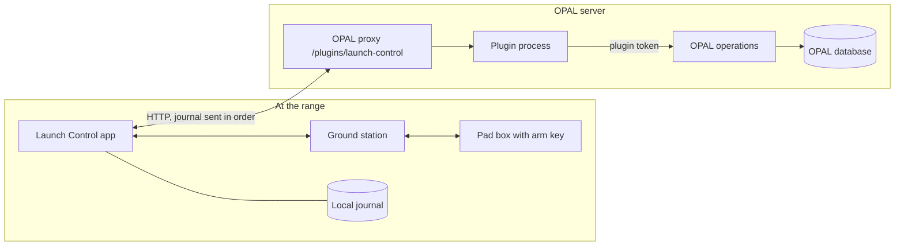

# Launch Control design

Launch Control is an app for amateur sounding-rocket launches. The launch director runs the count on it. The vehicle has a high-power solid motor, a flight computer, recovery pyro channels and thrust vector control. The pad has a box with a physical arm key and an igniter continuity check. Telemetry comes over LoRa.

The app is in `launch-control/app`. It is a SvelteKit app with vendored shadcn-svelte. It follows the design language of OPAL in `STYLE.md`. The plugin is a concept. It has no code yet. The contract between the app and the plugin is `app/src/lib/opal/link.ts`. The simulator is `app/src/lib/launch/sim.svelte.ts`. The prototype runs on simulated data. It has no pad hardware yet.

## 1. What this is and why it is separate

Launch Control is not a page in OPAL. It is a separate app. There are three reasons.

1. A launch must not depend on the OPAL server. The count runs on the Launch Control app and the pad box. A lost OPAL link changes nothing on the pad. The status bar shows ONLINE, STALE or OFFLINE.
2. The hardware bridge lives near the pad. It talks to the pad box and the ground station over serial or LoRa. OPAL runs on a server that may be far away. A handler in OPAL must never open a serial port.
3. OPAL keeps the record. The flight is a record that follows the paper test in `CLAUDE.md`. Launch Control keeps a local journal. It sends the journal to OPAL in order. OPAL stays the one home of each fact.

Launch Control links to OPAL only through the OPAL plugin. It never calls the OPAL API itself.

## 2. Architecture

The links between the two groups can fail at any time. The links inside the range group carry the count.

1. The app and the ground station exchange telemetry and commands. The pad box is the real interlock.
2. The app sends journal entries to the plugin. Each entry has a `seq`. The plugin accepts each `seq` once.
3. The plugin calls OPAL operations with its scoped token.
4. The app reads the flight, the steps and the signatures from the plugin.

### The plugin concept

The plugin does not exist as code. This is what it would do. It would follow `packages/plugin-sdk/README.md`. It would be one program that OPAL starts and stops. It would listen on the port that OPAL gives it. OPAL would reach it at `/plugins/launch-control/...`.

The manifest would have these parts. The values are a sketch.

| Field | Content |
|---|---|
| `id`, `name`, `version`, `main` | `launch-control`, a name, a version, and the bundle in `dist/plugin.js` |
| `permissions.ops` | Only the operations that the routes below need. For example executions, stock, datasets and issues. |
| `settings` | None are decided. A secret for the app would be one candidate. |
| `panels` | One panel in the slot `execution.side`. |

The routes come from `link.ts`.

1. `GET /api/flights` lists flights with their execution and state.
2. `GET /api/flights/:number` returns the linked flight.
3. `POST /api/flights` cuts the work order from a released procedure and links it.
4. `POST /api/flights/:number/journal` accepts journal entries. It is idempotent by `seq`.
5. `POST /api/flights/:number/samples` appends telemetry rows to the dataset.
6. `GET /panel/execution?execution=<id>` shows the flight in the `execution.side` panel in OPAL.

The plugin would keep the last accepted `seq` of each flight in its data folder. It would call OPAL only with its token. It would not sign for anyone.

## 3. The flight is a record in OPAL

| Launch Control concept | OPAL record or operation |
|---|---|
| Flight, `FLT-` number | A plugin link record. It ties one execution to the vehicle, the motor and the dataset. The number follows the sequence rules in `CLAUDE.md`. |
| Countdown | An execution (work order) cut from a released procedure. `POST /api/flights` cuts it. |
| Count step | A step of the execution. The system stamps who and when. The title is struck through. |
| Hold time on a step | `notBefore` on the procedure step. It is authored in the procedure. |
| Poll GO from the range safety officer | A sign-off slot on a step. The RSO signs it in OPAL. It is `humanOnly`. Launch Control reads the signature and cannot sign. |
| Motor | A stock lot. It is allocated at cut and consumed at fire. |
| Telemetry | Rows appended to an OPAL dataset in the flight project. |
| Requirements | Linked requirements. Apogee, recovery and landing evidence verify them. |
| Anomaly | An OPAL issue. Launch Control opens the issue form in a new tab. It carries the execution and the step. It asks only for a title. |
| Risk | A linked risk. A realized risk is stamped on the flight. |
| Hold, resume, scrub, arm, safe, fire | Entries in the journal. The plugin writes them to the execution as notes and stamps. |
| Scrub | A strike of the whole flight. It needs a reason. The record stays legible. |

### Commit moments

Before a commit moment the record is pencil. After it the record is pen.

1. Poll GO. The RSO signs in OPAL. The poll answers become pen.
2. Arm. The system stamps who and when. The pad key position goes with it.
3. Fire. The system stamps the time of the fire command and the motor lot.
4. Landed. The landing call and position become pen.
5. Closed. The flight record is terminal.

The plan is pencil until the count starts. The plan is the procedure, the crew, the motor and the window. A correction after a commit shows the old value, the new value, who, when and why.

An operation does not abort. A flight that cannot start is voided. A started flight that cannot finish is closed short with a reason and a linked issue.

## 4. Fail-safe asymmetry

Every move toward safe is one action. It is always offered. Every move toward hazard is gated and takes two actions.

| Toward safe | Toward hazard |
|---|---|
| HOLD. One key. It is always offered. | ARM. It opens at T−0:30 and needs a GO poll. |
| SAFE. One action. It drops the software arm. | FIRE. Press and hold for 1 second. A short press does nothing. |
| SCRUB. One action with a reason. | RESUME. It needs the poll GO and a separate director action. |

These rules hold in the simulator.

1. A broken commit criterion holds the count and drops the arm. Examples are stale telemetry, a lost link, lost igniter continuity and wind over the limit.
2. A hold before T−1:00 stops the clock at that time.
3. A hold after T−1:00 recycles the count to T−1:00. The poll must be called again.
4. The software arm cannot fire alone. The physical pad key is the real interlock.
5. The app shows the pad key position as telemetry. It cannot turn the key.
6. Releasing the FIRE key before 1 second cancels the fire with no effect.
7. The count never waits on OPAL. A lost OPAL link does not hold the count. It is not a commit criterion.

OPAL is the record and not a safety barrier. The pad key and the pad box circuit must stop the igniter with no software.

## 5. Open problem: identity

OPAL stamps the plugin user on every act that the plugin does through its token. A step that the operator completes in Launch Control then shows the plugin user. It should show the operator. Rule 12 in `CLAUDE.md` applies. No request header gives identity. The plugin cannot use `X-Opal-User` for this, because Launch Control is not inside an OPAL page.

There are two options.

**Option (a). A delegated per-person token.** OPAL adds a token for an external app. A person pairs the app with a device code. The person signs in to OPAL, enters the code and approves. The app then holds a token that acts as that person with a limited scope. Rule 12 stays true. Token actors still cannot do `humanOnly` operations. The RSO still signs in OPAL.

**Option (b). Same-origin service.** OPAL serves Launch Control on its own origin. The app calls OPAL with the session cookie of the person. No new token is needed.

We recommend option (a). Launch Control must run standalone at the range. The range may have no route to the OPAL server for hours. Option (b) needs the OPAL origin to be reachable when the page loads. It also ties the app to the OPAL release. With option (a), the pairing happens once, on the network of the server. The token then works from the range when the link returns. The journal carries the operator name from the first entry. The plugin replays it with the token of that operator.

Open questions for option (a):

1. How long does a delegated token live? The range may be offline for a day.
2. Does the token carry the full permission list of the person or a subset?
3. How does OPAL show a revoked pairing?

Until OPAL has option (a), the journal entry carries `by` as text. The plugin writes the operator name into the note. The stamp shows the plugin user. This is a known gap.

## 6. Human-factors design basis

The table lists what the app does and where the reference comes from. A section number appears only where a search result showed it. Where a number is not confirmed, the table gives the document only. Section 8 tells how each source was checked.

| Design choice | Standard | Where |
|---|---|---|
| Master warning and master caution annunciators sit in the primary field of view and need acknowledge | 14 CFR 25.1322 and AC 25.1322-1 (master alerts). Section not verified. | `AlertList.svelte`, `SimBanner.svelte` |
| Red for warning, amber for caution, a color that is not red or green for advisory | 14 CFR 25.1322 (colors). Not verified in the search text. Also the STYLE.md importance ladder. | `AlertList.svelte`, state fills in `CountdownBar.svelte` |
| Alerts use two senses: visual and tone. The warning tone repeats until acknowledged. The caution tone sounds once. | 14 CFR 25.1322(c)(2) is named for an aural cue beside a visual cue in an FAA guidance summary. AC 25.1322-1 asks for a unique tone for each master alert. Paragraph numbers in the AC not verified. | `AlertList.svelte`, `sim.svelte.ts` audio, MUTE key |
| An alert latches until a person acknowledges it | Same rule as OPAL STALE in STYLE.md. AC 25.1322-1 on acknowledge. Section not verified. | `AlertList.svelte` |
| Word and color together. The word carries the meaning. | NASA Human Integration Design Handbook chapter 10. FAA HF-STD-001B. MIL-STD-1472H. Sections not verified. | Every state fill |
| Stale telemetry is marked. The value is quieted and not hidden. | NASA Human Integration Design Handbook chapter 10. Section not verified. | `TelemetryPanel.svelte` |
| A critical command needs two actions and a hold. | MIL-STD-1472H on guarded controls. NASA-STD-3001 Volume 2 section 10. Sections not verified. | `IgnitionPanel.svelte` |
| The count clock and HOLD stay in the same place on every state | NASA-STD-3001 Volume 2 V2 10005 (consistent crew interfaces, section 10.1.1). Verified from search result. V2 10006 asks for standard nomenclature. | `CountdownBar.svelte` |
| Every value shows its unit | OPAL rule 11 in `CLAUDE.md`. NASA Human Integration Design Handbook chapter 10. Section not verified. | `TelemetryPanel.svelte`, `CriteriaPanel.svelte` |
| Text is at least 12px | STYLE.md Type. | All components |
| Contrast is at least 4.5:1 | STYLE.md Importance. WCAG 2.x as a common basis. Section not verified. | Tokens in the app stylesheet |
| No modals during the count | OPAL rule 9 in `CLAUDE.md`. | All components |
| HOLD is always available | Section 4 of this document. | `CountdownBar.svelte`, key H |
| Warnings come before the step in the order warning, caution, note. They hold no action. | OPAL rule 10 in `CLAUDE.md`. | `CountSteps.svelte` |
| The event log shows UTC and T-time on every row | OPAL rule 6 in `CLAUDE.md`. Standard flight-test practice. | `EventLog.svelte` |
| The poll shows who answered and when. The app cannot answer for a role. | OPAL rule 14 in `CLAUDE.md`. | `PollPanel.svelte` |
| The flight record shows the OPAL numbers and links | OPAL rule 4 in `CLAUDE.md`. | `FlightRecord.svelte` |

### Range rules the app checks

| Rule | Source | App behavior |
|---|---|---|
| Launch does not proceed in wind over 20 mph (8.9 m/s) | NAR High Power Rocket Safety Code. Verified from search result. | Wind is a commit criterion. A gust breaks it and the count holds. |
| The launch system has a safety interlock in series with the launch switch. The interlock is not installed until the rocket is ready. The launch switch returns to off when released. | NAR High Power Rocket Safety Code. Verified from search result. | The pad key is the interlock. The FIRE key cancels on release. |
| A 5-second countdown before launch, and a way to warn people if something goes wrong | NAR High Power Rocket Safety Code. Verified from search result. | The count is longer than 5 seconds. The warning tone is a prototype only. The range needs a horn. |
| Launcher distance from people and buildings | NAR code and NFPA 1127. Values not verified. | Step 1 posts the range. The prototype uses 30 m for the pad crew only. |
| Notice to air traffic control before launch | 14 CFR 101.27 is the ATC notification section. 101.29 lists the content of the notice. Verified from search result. 101.25 is the operating limitations section for Class 2 and Class 3 rockets. | A count step for the ATC notice is a candidate. It is not in the prototype. |

Flight termination, as in RCC 319, is out of scope. The app has no command destruct and no termination channel.

## 7. Not in the concept

Real hardware needs these items. They are not in the concept yet.

1. An independent hardware interlock. The physical key and the pad box circuit must stop the igniter with no software.
2. The hardware bridge for the pad box and the ground station. It runs near the pad.
3. A latency budget. Fire, hold and safe need a measured round trip. A command that misses the budget is refused and shown as refused.
4. Audio on the range. A browser tone is not enough. The crew needs a horn or an announcement.
5. A time source. GPS time stamps the count and the log. The browser clock is not a time source for a fire command.
6. Link supervision. The bridge sends a heartbeat. A lost heartbeat drops the arm on the pad box.
7. A test on the pad with a dummy igniter before the first live use.
8. A review of the whole design by the range safety officer. This document is a design basis and not an approval.
9. The identity solution in section 5.

## 8. Sources

The proxy of the session blocks nasa.gov, faa.gov, ecfr.gov and nar.org for fetch. The checks below use only the text of web search results. "Verified from search result" means the result text stated the item. It does not mean the primary document was opened.

| Source | Item | Status |
|---|---|---|
| NASA-STD-3001 Volume 2, section 10 | V2 10005 consistent crew interfaces, V2 10006 standard nomenclature, both under 10.1.1. https://www.nasa.gov/reference/10-0-crew-interfaces-vol-2 | Verified from search result |
| NASA-STD-3001 Volume 2 | Requirement IDs for caution and warning and for critical controls | Not verified. No ID found. |
| NASA/SP-2010-3407/REV1 Human Integration Design Handbook | Chapter 10 section numbers. https://www.nasa.gov/sites/default/files/atoms/files/human_integration_design_handbook_revision_1.pdf | Document found. Section numbers not verified. |
| MIL-STD-1472H | Control guard and alarm sections | Not verified. The search returned only vendor pages. |
| FAA HF-STD-001B | Any section | Not verified. |
| 14 CFR 25.1322 | Paragraph (a)(1)(i) on information to identify non-normal conditions. https://www.law.cornell.edu/cfr/text/14/25.1322 | Verified from search result |
| 14 CFR 25.1322 | Paragraph (c)(2) on an aural cue beside a visual cue, named in an FAA guidance summary | Verified from search result, second hand |
| 14 CFR 25.1322 | Color rules (red, amber, other) | Not verified |
| AC 25.1322-1 | Issued 2010-12-13. A unique tone for master warning and for master caution, in a guidance summary. https://www.faa.gov/documentLibrary/media/Advisory_Circular/AC_25.1322-1.pdf | Verified from search result. Paragraph numbers not verified. |
| NAR High Power Rocket Safety Code | Interlock in series with the launch switch, 5-second countdown, 20 mph wind limit. https://www.nar.org/?p=74 | Verified from search result |
| NFPA 1127 | Any section | Not verified |
| 14 CFR 101.25 | Title: operating limitations for Class 2 and Class 3 rockets | Verified from search result |
| 14 CFR 101.27 | Title: ATC notification for all launches | Verified from search result |
| 14 CFR 101.29 | Content of the notice | Verified from search result |
| RCC 319 | Named only to place it out of scope | Not verified |
